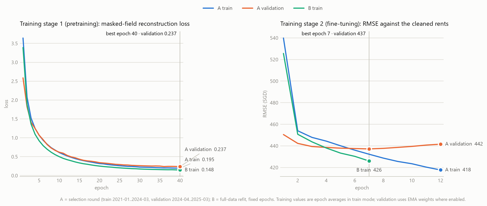
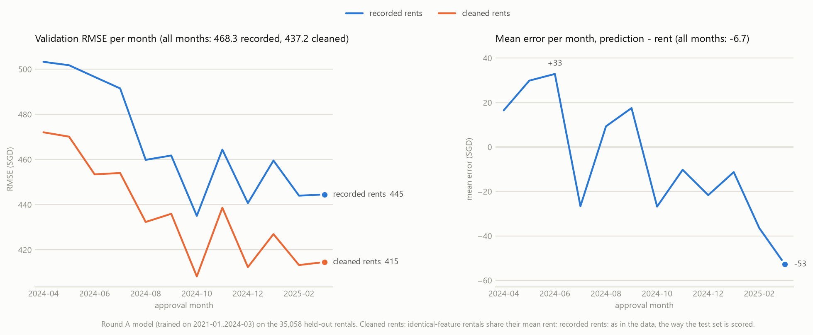
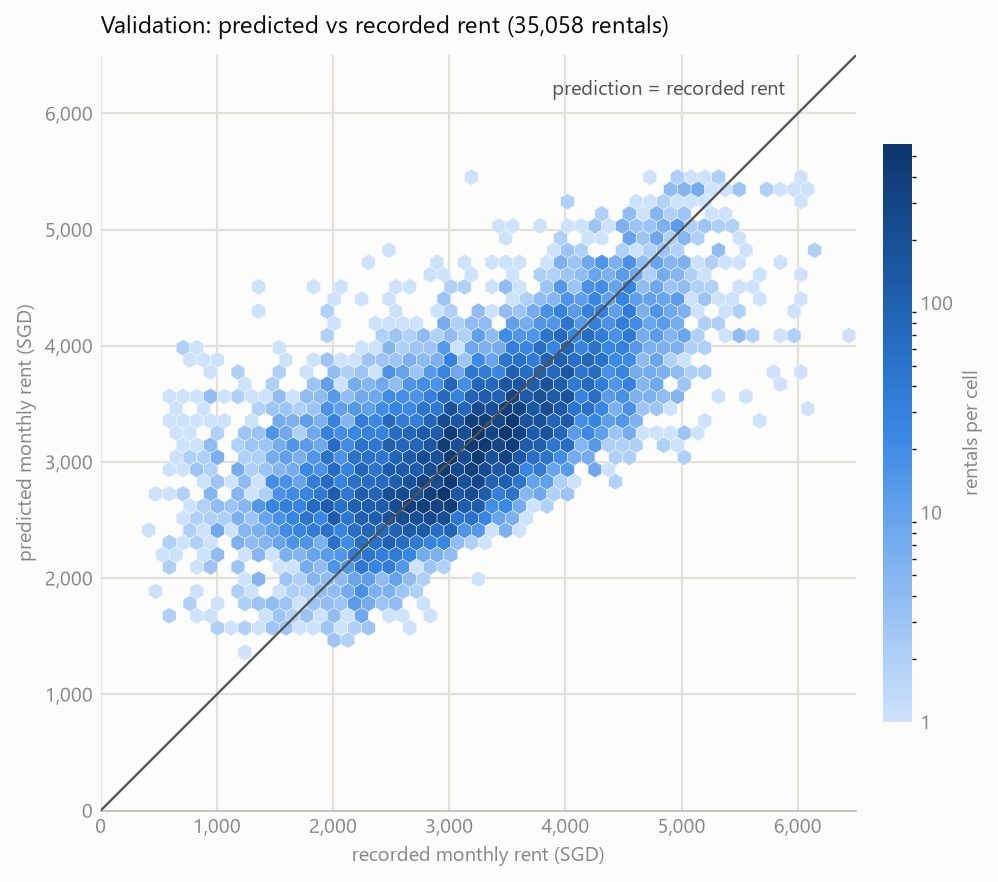
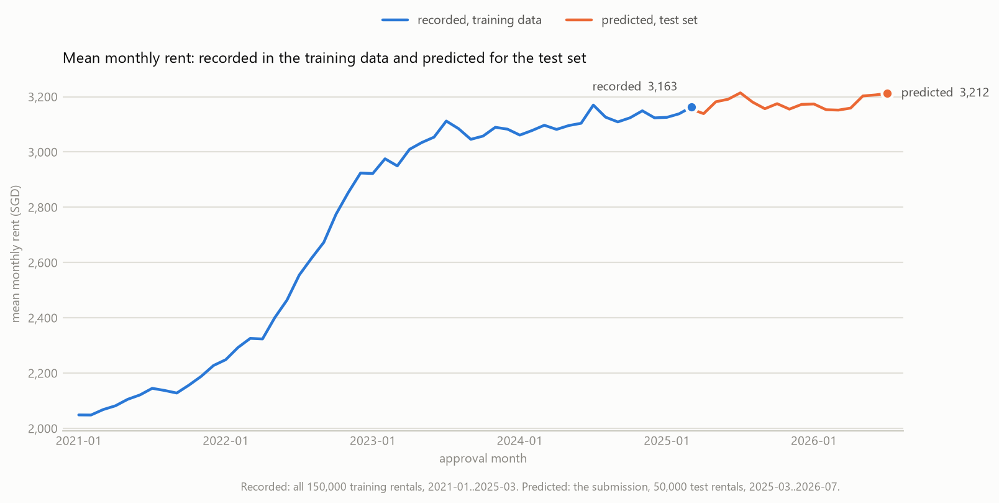

# HDB rental price prediction with a two-stage tabular BERT

This project predicts the monthly rent of Singapore HDB flats (CS5228 project, regression, scored by RMSE). Every rental record is turned into a short sequence of field tokens and fed to a BERT encoder that is first pretrained to reconstruct masked fields and then fine-tuned to predict the rent.

Project documents are available in this working tree: [proposal text](proposal/main.md), [progress slides (PDF)](proposal/slides.pdf), [editable slides](proposal/slides.md), [14-slide plan and responsibilities](proposal/SLIDE_PLAN.md), [EDA report](docs/EDA_REPORT.md), and [method research index](docs/research/README.md). These restored documents retain the earlier proposal draft; the BERT results below have not yet been incorporated into that draft.

| | |
|---|---|
| Submission | `results/submission_bert_two_stage.csv` (50,000 predictions) |
| Model | 12-layer BERT encoder over 29 field tokens, 86 million parameters |
| Validation RMSE | **468.3 SGD** on the last 12 months of labelled data (35,058 rentals); always predicting the training mean gives 842.5 |
| Training time | about 4 h 45 min on one RTX 5090 Laptop GPU |

```
../data/                   raw CSV files (read-only)
  |  preprocessing stage 1   unify formats, clean the training rents      -> ../data_preprocess/stage1
  |  preprocessing stage 2   join building facts and nearby facilities    -> ../data_preprocess/stage2
  |  preprocessing stage 3   encode every feature as a number             -> ../data_preprocess/stage3
  |  training stage 1        masked-field pretraining (rents not used)
  |  training stage 2        fine-tuning on the rent
  v  test                    predict the test set                         -> results/
```

"Preprocessing stage" and "training stage" are different things: the first three steps prepare data, the next two train the model.

## 1. Task and data

| File | Rows | Content |
|---|---:|---|
| `train.csv` | 150,000 | rentals approved 2021-01 to 2025-03, with `MONTHLY_RENT` (300 to 7,600 SGD, mean 2,719) |
| `test.csv` | 50,000 | rentals approved 2025-03 to 2026-07, rent to be predicted |
| `auxiliary/sg-hdb-block.csv` | 9,464 | every HDB block: coordinates, highest floor, completion year, subzone, planning area, region |
| `auxiliary/sg-mrt-stations.csv` | 243 | MRT stations with coordinates |
| `auxiliary/sg-schools.csv` | 337 | schools with level and coordinates |
| `auxiliary/sg-shopping-malls.csv` | 113 | malls with coordinates |

Each rental has an approval month, town, block, street, flat type, flat model, floor area and lease start year. `FURNISHED` is always "yes" and `FEE` always 0. The COE and stock-price tables are not used.

Two properties of the data shape the whole design:

- **The test set lies in the future.** Almost all test months come after the last training month, so the model is validated on the last 12 months of the labelled data, never on a random sample.
- **Many rentals have identical features but different rents.** 27% of the training rows share all their features (same block, flat type, model, area, lease year and month) with another row. These are different flats in the same block; floor level and condition are not in the data.

## 2. Preprocessing

`src/scripts/preprocess.py` builds `../data_preprocess` in three stages. Each stage writes CSV files into its own folder, so every step can be inspected, together with `schema.json` (column types) and `report.json` (what changed).

### Stage 1: unify formats, clean the training rents

| Step | What it does | Effect |
|---|---|---|
| Text normalization | Unicode NFKC, trim, lowercase, single spaces | `STREET`: 1,146 spellings become 576 in train (30,781 rows), 1,129 become 573 in test |
| Flat type spelling | "4 room" is written "4-room" | 11 values become 6 (35,331 train rows) |
| Missing markers | "NIL" postal codes and -1 building facts become empty | 285 postal codes; highest floor and completion year of 11 blocks |
| Number formats | "$40,609" and "1,280" become numbers; 5-digit school postal codes are zero-padded | auxiliary tables |
| Row identifier | `ROW_ID` = original row position | rows stay traceable through every stage |
| Rent outliers removed | see below | 315 training rows removed |
| Duplicate rents averaged | see below | 38,975 training rents replaced |

**Rent outliers.** A rent is compared with its comparables: other rentals of the same unit (town, block, street, flat type, flat model, floor area, lease year) approved within 2 months. With at least 3 comparables, a rent is an outlier if it is more than twice or less than half their median and differs from it by at least 800 SGD. Within a unit the most extreme outlier is removed first and the medians are recomputed, so one outlier cannot make a normal rent look extreme. 37,435 rows could be judged; 315 were removed (303 far below the median, 12 far above), for example a 3-room flat rented at 500 SGD where comparable rentals cost 2,925.

**Duplicate rents.** After outlier removal, rentals with identical features all receive the mean of their rents. 17,777 groups had differing rents. A model can only give identical inputs one prediction, and under squared error the best one is their mean, so this trains exactly like the separate rents but without contradictory labels. The original rent is kept in `MONTHLY_RENT_ORIGINAL`.

Every change is listed for review in `stage1/cleaning/removed_outliers.csv` (with the comparables used) and `stage1/cleaning/rent_replaced.csv`. The training set has 149,685 rows afterwards. The test set is not changed.

### Stage 2: building facts and nearby facilities

Each rental is matched exactly on (town, block, street) to the HDB block table; all rows match. This adds 17 columns:

| Source | Features |
|---|---|
| HDB block | `SUBZONE`, `PLANNING_AREA`, `REGION`, `LATITUDE`, `LONGITUDE`, `MAX_FLOOR`, `YEAR_COMPLETED` |
| MRT stations | distance to the nearest station, mean distance to the nearest 3, stations within 500 m and within 1,000 m |
| Schools | distance to the nearest primary school, to the nearest secondary school, primary schools within 1,000 m |
| Malls | distance to the nearest mall, malls within 1,000 m and within 2,000 m |

Distances are Haversine distances in metres. MRT stations count only from their first full month of operation, according to an explicit opening calendar (`src/preprocess/mrt_calendar.json`): 122 stations in 2021-01, 143 from 2025-03. A rental therefore never sees a station that had not opened yet. Schools (182 primary, 147 secondary) and malls (113) are a fixed snapshot.

### Stage 3: every feature as a number

The model receives 30 inputs per rental:

| Group | Columns | Encoding |
|---|---|---|
| Category IDs (8) | `TOWN_ID` (26 values), `STREET_ID` (576), `BUILDING_ID` (9,464), `SUBZONE_ID` (156), `PLANNING_AREA_ID` (31), `REGION_ID` (5), `FLAT_MODEL_ID` (20), `FLAT_TYPE_ORD` (6, ordered by size) | integer 1..N, 0 = unknown. Vocabularies come from the HDB block table (flat model: from train), so they depend on neither rents nor the validation split |
| Numbers (9) | `FLOOR_AREA_SQM`, `LEASE_COMMENCE_DATE`, `AGE_YEARS`, `MONTH_INDEX`, `LATITUDE`, `LONGITUDE`, `MAX_FLOOR`, `YEAR_COMPLETED`, `COMPLETION_AGE` | z-score |
| Facility numbers (10) | the MRT, school and mall distances and counts | log1p, then z-score |
| Calendar month (2) | `MONTH_SIN`, `MONTH_COS` | sine and cosine of the month of the year |
| Flag (1) | `HDB_INFO_MISSING` | 1 if the building facts were imputed |

- **Derived columns.** `MONTH_INDEX` counts months from 2021-01 (training 0 to 50, test 50 to 66). `AGE_YEARS` is the approval year minus the lease start year; `COMPLETION_AGE` is the approval year minus the completion year.
- **Imputation.** 11 blocks (159 training rows, no test rows) lack highest floor and completion year. The completion year is set to the lease year minus 1 (the typical gap) and the highest floor to the median of the blocks on the same street.
- **Standardization.** Means and standard deviations are computed once, on the features of the 149,685 training rows, and applied to both train and test. Rents are not involved.
- **Dropped.** The constant `FURNISHED` and `FEE`, and the text columns now represented by IDs.

`stage3/encoder.json` records every vocabulary, mean and standard deviation, so each value can be decoded.

## 3. Model

Each rental becomes a sequence of 30 vectors of width 768: one token per field plus a `[CLS]` token.

| Token | Count | How it is built |
|---|---:|---|
| Category ID | 8 | embedding lookup (32 dimensions for the building, 16 for town and street, 8 for the others), then a linear layer to 768 |
| Number | 19 | a small network per field: 1 -> 32 -> 768 with GELU |
| Calendar month | 1 | linear layer on (sine, cosine): 2 -> 768 |
| Flag | 1 | linear layer: 1 -> 768 |
| `[CLS]` | 1 | learned vector, placed first |

```
30 inputs of one rental
   -> 29 field tokens + [CLS]                    (30 x 768)
   -> BERT encoder: 12 layers, hidden size 768, 12 attention heads, feed-forward 3072, dropout 0.1
        training stage 1: every masked field token -> its own head -> reconstruct the field
        training stage 2: [CLS] -> LayerNorm -> Linear 768-256 -> GELU -> Dropout -> Linear 256-1 -> rent
```

The encoder is the Hugging Face `BertModel`, randomly initialized (no text pretraining). Its position embeddings tell the model which field each token is, because fields always appear in the same order. The pretraining model has 93.9 million parameters, the regression model 86.2 million.

## 4. Training

### Two training stages

1. **Pretraining (rents not used).** For each rental, every field group is masked with probability 0.15 (at least one group is always masked) and replaced by a learned mask vector. The model reconstructs the masked fields: cross-entropy for category IDs, squared error for numbers and the calendar month, binary cross-entropy for the flag; the three averages are summed. Fields that determine one another are masked together, so the task is not a lookup: `MONTH_INDEX` with the calendar month, and lease year, age, completion year and completion age.
2. **Fine-tuning.** The pretrained encoder is loaded and the regression head predicts the standardized rent, (rent - mean) / standard deviation of the training rows, with squared-error loss. Predictions are converted back to SGD before scoring. An exponential moving average (EMA) of the weights is kept and used for validation and for the saved model.

### Two rounds

| | Round A (`select`) | Round B (`refit`) |
|---|---|---|
| Purpose | choose the number of epochs, report validation scores | train the model that predicts the test set |
| Training rows | 2021-01 to 2024-03: 114,627 | all 149,685 |
| Validation rows | 2024-04 to 2025-03: 35,058 | none |
| Epochs | early stopping: keep the best validation epoch, stop after 5 epochs without improvement | exactly round A's best epoch of each stage |
| Rent scaling | mean 2,597, standard deviation 709 (training months) | mean 2,722, standard deviation 727 (all rows) |

Round A is scored by reconstruction loss on the validation months' features in stage 1 and by validation RMSE in stage 2. Round B starts from scratch: it pretrains and fine-tunes again on all rows and never looks at a validation score.

### Configuration (`configs/bert.json`)

| Setting | Training stage 1 | Training stage 2 |
|---|---|---|
| Maximum epochs | 40 | 60 |
| Early-stopping patience (round A) | 5 epochs | 5 epochs |
| Optimizer | AdamW, weight decay 0.01 | AdamW, weight decay 0.01 |
| Peak learning rate | 1e-4 | 2e-5 for the encoder, 1e-4 for the regression head |
| Schedule (per epoch) | linear warm-up over 2 epochs, then cosine decay to 10% at the last configured epoch | linear warm-up over 3 epochs, then cosine decay to 10% |
| Batch size | 1,024 | 1,024 |
| Gradient clipping | norm 1.0 | norm 1.0 |
| Masking probability | 0.15 per field group | not used |
| Weight EMA | not used | decay 0.995 |
| Dropout | 0.1 | 0.1 |

Seed 42, 32-bit floats, deterministic settings. The validation split is the last `validation_months` = 12 approval months.

## 5. Results

All figures are drawn by `src/scripts/plot_results.py` from the files the run recorded.

### Training

| | Round A | Round B |
|---|---|---|
| Stage 1 | 40 epochs, best epoch 40, validation reconstruction loss 0.237 (training 0.195) | 40 epochs, training loss 0.148 |
| Stage 2 | 12 epochs, best epoch 7 | 7 epochs, training RMSE 426 |
| Time | 1 h 50 min + 30 min | 2 h 05 min + 20 min |



Pretraining improves until the last epoch. Fine-tuning reaches its best validation RMSE at epoch 7; after that the training error keeps falling while the validation error rises, so early stopping matters.

### Validation (round A model, 35,058 rentals of 2024-04 to 2025-03)

| Scored against | RMSE | MAE | Mean error |
|---|---:|---:|---:|
| Recorded rents (the way the test set is scored) | **468.3** | 344.8 | -6.7 |
| Cleaned rents (used for early stopping) | 437.2 | 317.7 | -6.7 |
| Reference: always predict the training mean, recorded rents | 842.5 | | |

The two RMSE values are linked by a constant: rentals with identical features get the same prediction, so the spread of their recorded rents around their mean cannot be predicted by any model. That spread is 168 SGD over the validation rentals, and 468.3² = 437.2² + 168². In the result files the recorded-rent scores are called `original_rent`.

| Month | Rentals | RMSE, recorded rents | RMSE, cleaned rents | Mean error |
|---|---:|---:|---:|---:|
| 2024-04 | 3,126 | 503.3 | 472.1 | +16.5 |
| 2024-05 | 3,008 | 501.8 | 470.1 | +29.9 |
| 2024-06 | 2,997 | 496.6 | 453.5 | +32.9 |
| 2024-07 | 3,237 | 491.5 | 454.0 | -26.6 |
| 2024-08 | 2,826 | 459.9 | 432.3 | +9.3 |
| 2024-09 | 2,695 | 461.8 | 436.0 | +17.5 |
| 2024-10 | 2,658 | 435.1 | 408.3 | -26.8 |
| 2024-11 | 2,713 | 464.4 | 438.7 | -10.2 |
| 2024-12 | 2,889 | 440.7 | 412.4 | -21.6 |
| 2025-01 | 2,863 | 459.6 | 427.0 | -11.3 |
| 2025-02 | 3,017 | 444.0 | 413.3 | -36.5 |
| 2025-03 | 3,029 | 444.5 | 414.6 | -52.8 |



The error does not grow with the distance from the training period, but the predictions drift from slightly too high to about 50 SGD too low: rents kept rising slowly and a model trained up to 2024-03 does not follow. This is why round B retrains on all months before predicting the test set.



Predictions follow the recorded rents along the diagonal but cover a narrower range (1,382 to 5,425 SGD against 400 to 6,500): very cheap and very expensive rentals are pulled towards the typical rent of their kind of flat.

### Test-set predictions (round B model)

`results/submission_bert_two_stage.csv` holds 50,000 predictions between 1,333 and 5,452 SGD with a mean of 3,177.



The predicted level continues the last recorded months (3,163 in 2025-03). The model predicts an almost flat level for the 16 months ahead; it has no information about how rents will move after the training period.

### What limits the score

- **Identical features, different rents.** The data cannot tell apart flats of the same kind in the same block and month. Even a model that predicted every such group's mean rent exactly would have an RMSE of 168 SGD on the validation rentals.
- **Outliers stay in the test set.** The validation rentals exclude 100 removed outliers; the test set still contains such rentals, so its RMSE is expected to be roughly 10 SGD higher than the validation RMSE for this reason alone.
- **Forecasting.** The test months lie up to 16 months after the training data; the model can only carry the last known level forward.
- **New buildings.** 102 test rentals are in 50 blocks without any training rental; the model has to rely on their location and flat attributes.

## 6. Reproduce

The defaults retain the original author's workspace layout: this Git repository, `data/` and `data_preprocess/` are siblings. Raw inputs are read from `../data`, including `train.csv`, `test.csv`, `auxiliary/` and the official `example-submission.csv`. Preprocessing writes `../data_preprocess/stage1`, `stage2` and `stage3`. Configuration paths such as `data_dir` are resolved relative to the repository root, regardless of the current working directory. A repository-local `data/` copy is not selected automatically.

Model checkpoints, per-row predictions and training histories are not included in Git. Full training or prediction requires the external input files and the dependencies below; reproducing prediction from the saved model also requires the author's completed `models/` directory. The recorded result JSON and figures were preserved during the directory reorganization, without rerunning the model.

Run from this folder; the commands work in cmd and PowerShell.

```
.venv\Scripts\python.exe src\scripts\preprocess.py
.venv\Scripts\python.exe -u src\scripts\train_stage1_pretrain.py
.venv\Scripts\python.exe -u src\scripts\train_stage2_finetune.py
.venv\Scripts\python.exe tests\test.py
.venv\Scripts\python.exe src\scripts\plot_results.py
```

| Script | What it does | Writes |
|---|---|---|
| `src/scripts/preprocess.py` | the three preprocessing stages (`--stage 1`, `2` or `3` reruns one) | `../data_preprocess/stage1`, `stage2`, `stage3` |
| `src/scripts/train_stage1_pretrain.py` | pretraining, round A then round B | `models/{select,refit}/pretrain/backbone.pt` |
| `src/scripts/train_stage2_finetune.py` | fine-tuning, round A then round B, and round A's validation report | `models/{select,refit}/finetune/model.pt`, `results/validation_summary.json`, `results/validation_predictions.csv`, `results/refit.json` |
| `tests/test.py` | predicts the test set with the round B model | `results/submission_bert_two_stage.csv` |
| `src/scripts/plot_results.py` | the four figures above | `results/figures/` |

- Both training scripts accept `--round select` or `--round refit` to run one round, and `--config`, `--model-dir`, `--results-dir` to keep a second experiment apart from this one. `tests/test.py` accepts `--model-dir`, `--round select` (predict with the round A model) and `--output`.
- Training resumes from the last finished epoch if it is interrupted; a run interrupted and resumed gives the same result as an uninterrupted one.
- `tests/test.py` refuses to overwrite an existing submission. When the completed run has been restored under `models/`, the training scripts find it and stop immediately; to train again from scratch, pass new `--model-dir` and `--results-dir` folders and a new `--output`.
- `powershell -ExecutionPolicy Bypass -File run.ps1` runs the two training scripts and the test script in order.
- Rerunning `tests/test.py` on the saved round B model reproduces the submission byte for byte, and rerunning the preprocessing reproduces `../data_preprocess`.

A CUDA GPU is required; the batch of 1,024 needs about 20 GB of GPU memory with this configuration (the first run probes the memory and uses a smaller micro-batch with gradient accumulation if needed).

### Environment

Python 3.12, PyTorch 2.10.0 (CUDA 12.8), Transformers 4.57.6, NumPy 2.3.5, pandas 3.0.1; `requirements.lock.txt` lists every package. `src/scripts/plot_results.py` additionally needs matplotlib.

```
python -m venv .venv
.venv\Scripts\python.exe -m pip install torch==2.10.0 --index-url https://download.pytorch.org/whl/cu128
.venv\Scripts\python.exe -m pip install -r requirements.lock.txt
.venv\Scripts\python.exe -m pip install matplotlib
```

## 7. Folder layout

| Path | Content |
|---|---|
| `src/preprocess/` | the three preprocessing stages, rent cleaning and the MRT opening calendar |
| `src/bert_rent/` | data loading (`data.py`), model (`model.py`), training loop (`engine.py`), shared setup (`run.py`) |
| `src/scripts/` | preprocessing, the two training stages, figures |
| `tests/test.py` | test-set prediction |
| `configs/bert.json` | the configuration of this run |
| `models/` | `select/` (round A) and `refit/` (round B), each with `pretrain/` and `finetune/`: kept model, per-epoch `history.json`, `summary.json`, and `latest.pt` for resuming |
| `results/` | `split.json`, `validation_summary.json`, `validation_predictions.csv`, `refit.json`, `environment.json`, `figures/`, `logs/`, `submission_bert_two_stage.csv` |
| `proposal/` | English proposal, editable slides and PDF, slide plan, presentation figures and build instructions |
| `docs/` | course requirements, team workflow, progress plan, EDA report and method research |
| `report/` | [chapter-based final-report outline](report/README.md), [preparation and evidence index](report/PREPARATION.md), and `latex/main.tex` |
| `notebooks/` | reproducible EDA scripts and their separate dependency list |
| `experiments/eda/` | recorded EDA tables, auxiliary-data audits and run manifest |
| `experiments/research/` | research planning outputs and supporting scripts |

The Git repository holds the code, configuration, small result files and figures. The Python environment, `models/`, the submission CSV, `results/validation_predictions.csv` and `results/logs/` are not in it (large, per-row or machine-specific); the commands in section 6 produce them.

## 8. Proposal, EDA and research documents

The proposal documents and their supporting EDA and research files have been restored into the current working tree from `7dbdb54`, alongside the author's two-stage BERT project at `6ed01ca`. The local `proposal` branch also preserves that earlier commit. No branch switch is needed to read or edit the documents.

- [Proposal README](proposal/README.md): document contents and slide build instructions.
- [Slide plan](proposal/SLIDE_PLAN.md): the 14-page structure, section allocation and owners. Pages 1–6 are drafted; pages 7–14 remain outlines pending completion.
- [EDA reproduction guide](notebooks/README_EDA.md): commands and dependencies for the restored EDA. Its default repository-local `data/` input is separate from the BERT pipeline's sibling `../data/` layout described in section 6.
- [Research index](docs/research/README.md): candidate methods, evidence, evaluation and priority planning.
- [Team workflow](docs/TEAM_WORKFLOW.md) and [progress plan](docs/PROGRESS_PLAN.md): responsibilities and planned deliverables.

The restored documents, figures and EDA outputs retain their original contents. Their progress statements describe the earlier proposal stage; the newer BERT experiment results remain in `results/` and in this README until the team updates the proposal. Restoring the files and organizing the code does not commit or push either branch.

`src/` holds implementation and runnable scripts. `tests/test.py` retains its existing meaning as the test-set prediction command; it is not an automated unit-test suite. Predictions now default to `results/submission_bert_two_stage.csv`, alongside the existing metric summaries and figures. Explicit `--output`, `--results-dir`, `--model-dir`, `--config` and preprocessing path arguments remain available.
