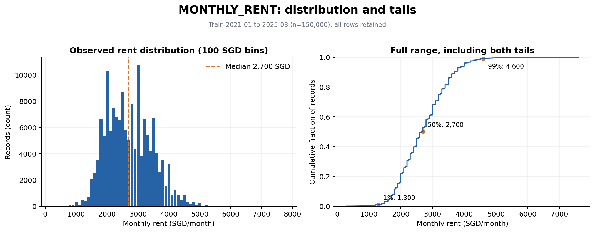
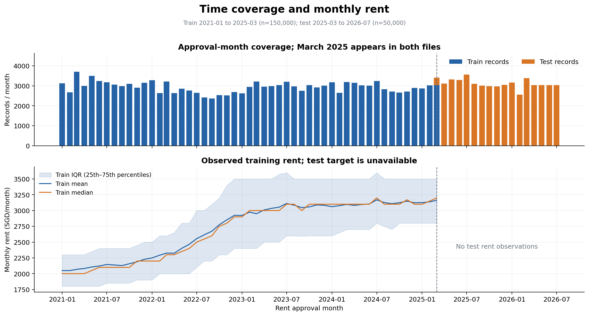
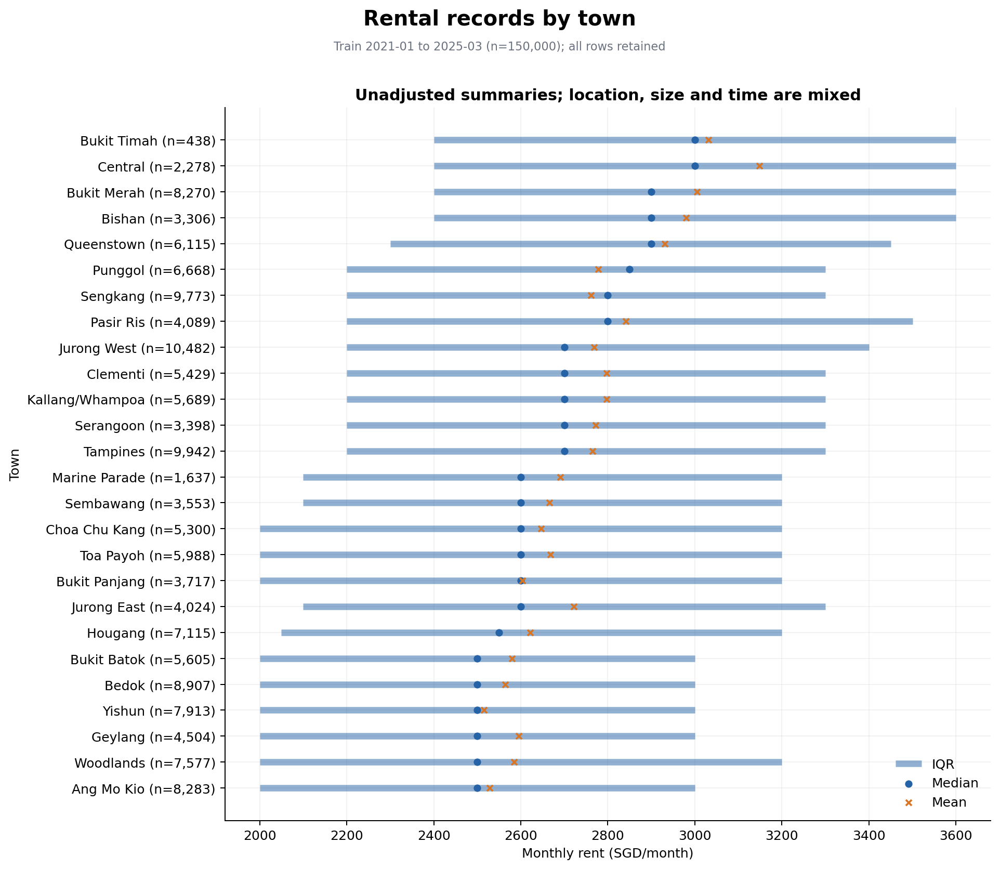
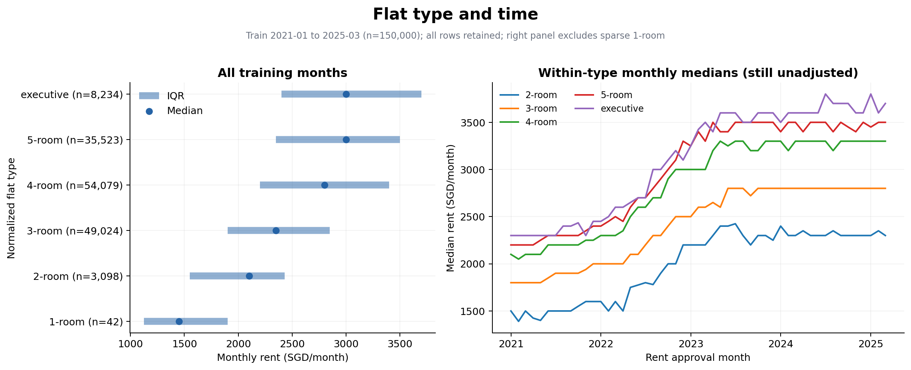
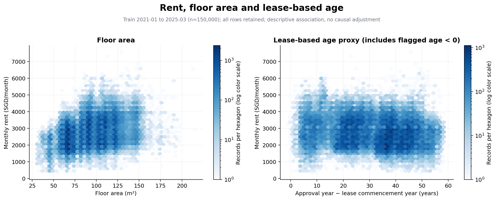
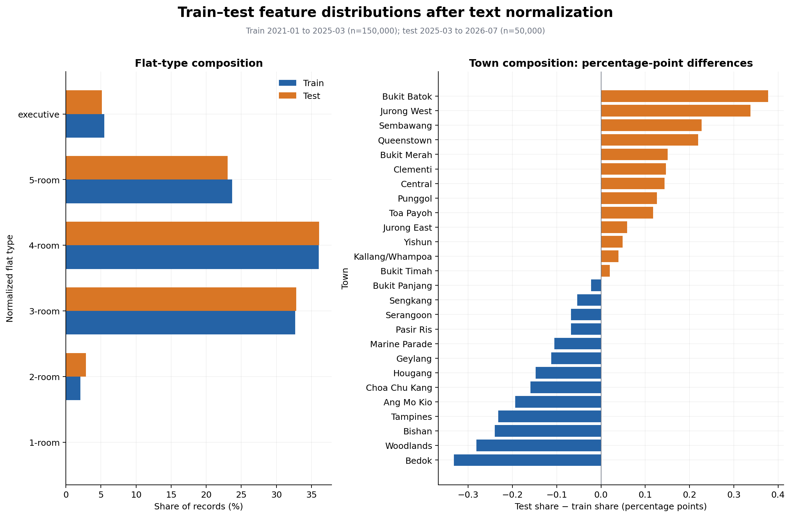
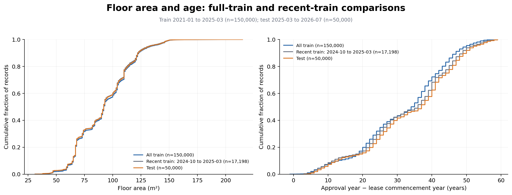

# 阶段一：EDA 与数据质量审计

本报告由 `python notebooks/run_eda.py` 根据本地 CSV 和运行结果生成，角色 A，提交团队审阅。范围仅为 EDA、质量审计及后续实验假设；没有训练模型、比较模型成绩、固定候选方案数量、生成预测或提交 Kaggle。没有改动原始 CSV、`proposal/main.md`、`proposal/slides.md` 或最终报告。

## 1. 数据、口径与复现

分析依据为 README、课程说明及三份团队指南。数字取自本次实际运行的 [核心汇总](../experiments/eda/core/summary.json)、[辅助汇总](../experiments/eda/auxiliary/summary.json) 和同目录明细表；不是从课程描述抄录。训练集 150,000 行、11 列，测试集 50,000 行、10 列。训练范围 2021-01–2025-03（51 个有记录月份），测试范围 2025-03–2026-07（17 个有记录月份）。测试文件没有 `MONTHLY_RENT`，代码对此有断言。

所有租金统计只用 train 的目标值。测试特征仅用于用户要求的分布、覆盖和连接审计，没有参与任何模型、编码器、填补器或阈值的拟合。全期间辅助表仅用于核查字段和时间边界，没有用未来经济观测构造历史或测试特征。内存中的规范化副本保留全部观测，不去重、不剔除尾部、不插补；输出 CSV 均在 `experiments/eda/`。

复现（从项目根目录，推荐 Python 3.12.14，依赖固定见 [requirements-eda.txt](../notebooks/requirements-eda.txt)）：

```bash
python3 -m venv .venv-eda
.venv-eda/bin/python -m pip install -r notebooks/requirements-eda.txt
.venv-eda/bin/python notebooks/run_eda.py
```

本机实跑使用 Codex bundled Python，绘图依赖安装在临时目录；可在当前环境复跑：

```bash
PYTHONPATH=/private/tmp/cs5228-eda-deps /Users/moyu114/.cache/codex-runtimes/codex-primary-runtime/dependencies/python/bin/python3 notebooks/run_eda.py
```

临时目录不保证跨会话存在；干净环境请使用上面的 venv 命令。依赖实跑版本为 pandas 2.2.3、NumPy 2.3.5、Matplotlib 3.10.6；不依赖 sklearn、SciPy、网络 API 或外部数据。完整分析使用全部记录，无随机抽样。[运行清单](../experiments/eda/run_manifest.json) 保存输入和代码 SHA-256、Python/包版本、受保护文件哈希及命令。脚本运行前后核对原始 CSV 与受保护文档哈希一致；源码运行时写入的路径限于本阶段交付物。

统计口径：缺失数含 pandas 识别的 NA，另外检查空白和辅助表哨兵值；唯一值数默认不含 NA。重复“多余行”是每个相同组保留一行后的剩余数量，仅作为统计定义，未实际删除。租金单位 SGD/月，面积 m²。`AGE_YEARS = 批准年份 − LEASE_COMMENCE_DATE` 是年度精度的租约楼龄代理，不是精确竣工楼龄。图中 IQR 是观测分布的 P25–P75，不是置信区间。

## 2. 核心字段与质量

| 字段 | 意义/单位 | train 读取类型 | train 范围/类别 | test 唯一值数 | train 缺失 | test 缺失 |
| --- | --- | --- | --- | --- | --- | --- |
| RENT_APPROVAL_DATE | 批准月份，YYYY-MM | object | 2021-01–2025-03 | 17 | 0 | 0 |
| TOWN | 城镇 | object | 26 个原始值 | 26 | 0 | 0 |
| BLOCK | 楼号字符串（不独立唯一） | string | 2,720 个原始值 | 2,660 | 0 | 0 |
| STREET | 街道字符串 | object | 1,146 个原始值 | 1,129 | 0 | 0 |
| FLAT_TYPE | 户型 | object | 11 个原始值 | 6 | 0 | 0 |
| FLAT_MODEL | 设计类别，勿与户型混同 | object | 20 个原始值 | 19 | 0 | 0 |
| FLOOR_AREA_SQM | m² | float64 | 31.0–215.0 | 148 | 0 | 0 |
| FURNISHED | 配置类别 | object | yes（常量） | 1 | 0 | 0 |
| LEASE_COMMENCE_DATE | 租约起始年份（非完整日期） | int64 | 1966–2022 | 57 | 0 | 0 |
| FEE | 费用，当前全为零；具体定义待确认 | float64 | 0.0（常量） | 1 | 0 | 0 |
| MONTHLY_RENT | SGD/月，只有 train 有 | int64 | 300–7600 | — | 0 | — |

两集所有核心字段的 NA 与空白字符串均为 0。月份全部能按 `%Y-%m` 解析，面积和租金均为正且有限，租约年份无非整数值。`BLOCK` 以字符串读取保留字母后缀；单独的楼号不是地址唯一键。原始字符串的最小/最大值仅有字典序意义；完整逐字段类型、范围及常量标记见 [field_overview.csv](../experiments/eda/core/field_overview.csv)，各类别完整频数见 [category_frequencies_raw.csv](../experiments/eda/core/category_frequencies_raw.csv)。

面积与租约年份范围核对：

| split | 字段 | 最小 | P25 | 中位数 | P75 | 最大 |
| --- | --- | --- | --- | --- | --- | --- |
| train | FLOOR_AREA_SQM | 31 | 68 | 92 | 110 | 215 |
| test | FLOOR_AREA_SQM | 31 | 68 | 92 | 110 | 215 |
| train | LEASE_COMMENCE_DATE | 1966 | 1981 | 1988 | 2001 | 2022 |
| test | LEASE_COMMENCE_DATE | 1966 | 1981 | 1988 | 2001 | 2022 |

`FURNISHED=yes` 与 `FEE=0.0` 在两集均为常量，现有样本无法估计它们与租金的关系。建议派生特征中排除并保留 schema 审计，不解释为“家具或费用没有影响”。FLAT_MODEL 在训练有 20 类，测试有 19 类；同名或罕见类别仍需折内处理，类别频数不等于预测效果。

### 2.1 类别写法

| split | 字段 | 原始类别数 | 规范化类别数 | 改变写法的行数 |
| --- | --- | --- | --- | --- |
| train | STREET | 1,146 | 576 | 30,781 |
| train | FLAT_TYPE | 11 | 6 | 35,331 |
| test | STREET | 1,129 | 573 | 10,482 |

保守规则为 Unicode NFKC → 去首尾空白 → 小写 → 连续空白压成一个空格；对 `FLAT_TYPE` 单独用 `^(\d+)\s*[- ]\s*room$` 映射成 `N-room`，`executive` 保持。不要把 FLAT_MODEL 的 `2 room` 与 FLAT_TYPE 混为同一字段，也不要将楼号转整数、删除后缀或凭猜测展开街道缩写。未发现需要模糊匹配才能连接 HDB 的证据。

训练户型频数（未删行）：

| raw | normalized | n |
| --- | --- | --- |
| 1 room | 1-room | 8 |
| 1-room | 1-room | 34 |
| 2 room | 2-room | 532 |
| 2-room | 2-room | 2,566 |
| 3 room | 3-room | 12,092 |
| 3-room | 3-room | 36,932 |
| 4 room | 4-room | 13,391 |
| 4-room | 4-room | 40,688 |
| 5 room | 5-room | 9,308 |
| 5-room | 5-room | 26,215 |
| executive | executive | 8,234 |

全部原值→规范值及数量在 [category_normalization_map.csv](../experiments/eda/core/category_normalization_map.csv)；可复用函数位于 [eda_core.py](../notebooks/eda_core.py) 的 `normalized_copy`。该函数只做确定性文本清洗，不学习全数据词表。

### 2.2 异常值与可疑值

| split | 仅用于标记的规则 | 下界 | 上界 | 界外行数 |
| --- | --- | --- | --- | --- |
| train | FLOOR_AREA_SQM_train_IQR_1.5 | 5 | 173 | 130 |
| train | AGE_YEARS_train_IQR_1.5 | -8 | 72 | 0 |
| train | MONTHLY_RENT_train_IQR_1.5 | 450 | 4,850 | 752 |
| test | FLOOR_AREA_SQM_train_IQR_1.5 | 5 | 173 | 43 |
| test | AGE_YEARS_train_IQR_1.5 | -8 | 72 | 0 |

IQR 界外定义为严格小于下界或大于上界。上下界只由全训练集的 P25/P75 计算，用于本次质量审计；后续验证若使用异常阈值，必须在每个训练折重新计算，不得沿用全训练阈值处理早期验证。IQR 不是错误判定，当前没有删除这些行。尤其租金尾部可能是真实交易，不能为了降低 RMSE 直接删去验证尾部。

负楼龄只有训练中 1 行：零基数据行 `31739`（CSV 含表头第 31741 行），`2021-11 / bedok / 153b / Bedok South Road`，租约年份 2022，年份差为 −1，租金 3,200 SGD/月。IQR 没有识别此语义异常，说明还需要逻辑校验。先保留异常指示；核查批准与起租/租约年份口径后，再决定是否在派生特征中置缺失。不要擅自把年份改成批准年或把年龄截成零。

更多详情见 [anomaly_flags.csv](../experiments/eda/core/anomaly_flags.csv) 和 [rent_extreme_examples.csv](../experiments/eda/core/rent_extreme_examples.csv)；后者是最低/最高租金的示例切片，不能当作穷尽的错误清单。

## 3. MONTHLY_RENT 的分布与关联

总体平均 2,719.04、标准差 749.73、中位数 2,700 SGD/月；范围 300–7,600，P1/P99 为 1,300/4,600，P25/P75 为 2,100/3,200。样本偏度 0.386，右尾存在但不能因此预设对数目标有效。98.72% 的租金是 50 SGD 的整数倍，表明值有明显离散集中；原因及是否为源数据舍入尚未核实。



图示保留全范围，直方图每格 100 SGD；累积分布显示尾部只占少量记录。RMSE 对较大残差敏感，后续应报告各租金区间误差；这不是截尾或改变目标函数的效果证据。

### 3.1 月份



观测事实：2021-01 平均租金 2,048.90（n=3,129），2025-03 为 3,162.71（n=3,032）。跨年的描述性统计如下，单位 SGD/月：

| YEAR | 样本数 | 平均租金 | 租金中位数 | P25 | P75 |
| --- | --- | --- | --- | --- | --- |
| 2021 | 37,619 | 2,121.14 | 2,100 | 1,800 | 2,400 |
| 2022 | 32,564 | 2,524.06 | 2,450 | 2,000 | 2,980 |
| 2023 | 35,654 | 3,035.90 | 3,000 | 2,500 | 3,500 |
| 2024 | 35,239 | 3,109.67 | 3,100 | 2,700 | 3,500 |
| 2025 Q1（非全年） | 8,924 | 3,142.46 | 3,150 | 2,800 | 3,500 |

训练中上升主要发生在较早区段，后期月均仍有波动。2025 行仅为第一季度，不能与全年平均当作同比增幅。月均和中位数同时受成交构成、月份和其他条件影响；图没有调整房源构成，不能作因果解释，也没有外推测试租金。

### 3.2 城镇与户型



按全训练期中位数排序，低端示例 `ang mo kio` 的中位数 2,500（n=8,283），高端示例 `bukit timah` 为 3,000（n=438）SGD/月。图中各城镇 IQR 广泛重叠，样本量不均；完整数值见 [rent_by_town.csv](../experiments/eda/core/rent_by_town.csv)。这是实际出租样本的边际分布，不能视为控制了面积和时间的地段溢价。



| FLAT_TYPE | 样本数 | 平均租金 | 租金中位数 | P25 | P75 |
| --- | --- | --- | --- | --- | --- |
| 1-room | 42 | 1,498.21 | 1,450 | 1,125 | 1,900 |
| 2-room | 3,098 | 1,979.52 | 2,100 | 1,550 | 2,430 |
| 3-room | 49,024 | 2,386.55 | 2,350 | 1,900 | 2,850 |
| 4-room | 54,079 | 2,837.88 | 2,800 | 2,200 | 3,400 |
| 5-room | 35,523 | 2,981.71 | 3,000 | 2,350 | 3,500 |
| executive | 8,234 | 3,069.33 | 3,000 | 2,400 | 3,700 |

单位 SGD/月。户型越大的组通常具有较高的描述性租金；但面积、年代和区域也随户型变化。右图按户型分层后仍观察到月度变化，因此“总体上涨全由户型比例改变造成”与这些图不一致，但其他构成影响尚未排除。1-room 训练样本仅 42 条，故右侧月线不展示该稀疏组，左侧与总量统计仍保留。各月各户型样本量可查 [rent_by_month_flat_type.csv](../experiments/eda/core/rent_by_month_flat_type.csv)。

### 3.3 面积与楼龄代理



六边形颜色表示格内记录数，对数色标，全训练样本无抽样。租金与面积 Pearson 相关 0.329、Spearman 秩相关 0.318；与年份差楼龄 Pearson 相关 -0.178。这些边际相关不足以解释条件效应或证明线性关系，年龄还同时携带批准年和租约起始年代的信息。

面积分箱（m²；左闭右开，最后一箱无上界），租金单位 SGD/月：

| AREA_BAND | 样本数 | 平均租金 | 租金中位数 | P25 | P75 |
| --- | --- | --- | --- | --- | --- |
| <50 | 2,867 | 1,978.14 | 2,100 | 1,550 | 2,400 |
| 50-<70 | 35,808 | 2,387.88 | 2,350 | 1,900 | 2,850 |
| 70-<90 | 22,835 | 2,564.57 | 2,500 | 2,000 | 3,000 |
| 90-<110 | 43,965 | 2,851.31 | 2,800 | 2,250 | 3,400 |
| 110-<130 | 34,513 | 2,956.43 | 3,000 | 2,300 | 3,500 |
| 130-<150 | 8,832 | 3,060.80 | 3,000 | 2,400 | 3,700 |
| 150+ | 1,180 | 3,127.84 | 3,000 | 2,500 | 3,800 |

楼龄代理分箱（年），租金单位 SGD/月：

| AGE_BAND | 样本数 | 平均租金 | 租金中位数 | P25 | P75 |
| --- | --- | --- | --- | --- | --- |
| <0 | 1 | 3,200 | 3,200 | 3,200 | 3,200 |
| 0-9 | 10,300 | 2,851.32 | 2,800 | 2,300 | 3,450 |
| 10-19 | 15,316 | 2,913.10 | 2,850 | 2,250 | 3,500 |
| 20-29 | 37,839 | 2,876.95 | 2,900 | 2,300 | 3,400 |
| 30-39 | 40,392 | 2,638.13 | 2,500 | 2,000 | 3,200 |
| 40-49 | 37,741 | 2,588.74 | 2,500 | 2,000 | 3,000 |
| 50+ | 8,411 | 2,466.39 | 2,450 | 2,000 | 3,000 |

面积组中位数在较大面积段没有按比例持续增长；楼龄组的差异也不是严格单调。可据此提出非线性和交互项实验，但不能确定其预测收益。

## 4. 训练与测试的时间、特征漂移

**事实**：测试共有 17 个日历月份，包含与训练重叠的 2025-03（train 3,032 行、test 380 行）。测试有 49,620 行（99.24%）晚于训练最大月份；最远 2026-07 相对 2025-03 的月序差为 16。因此“17 个月份”与“16 个月最大预测间距”同时成立，不能写成全部测试都在训练之后。月份内部没有日期，无法判断重叠月份交易的先后，也不能臆测按行号代表时间。课程说明截至 2026-06，而实际 CSV 到 2026-07，应由团队确认说明差异。



用 TVD = 0.5 × Σ|训练类别占比 − 测试类别占比| 描述类别差异，范围 0–1；没有把经验阈值或显著性检验当作模型选择标准。下表为规范化后结果，recent_train 指 2024-10–2025-03 的 17,198 行：

| field | all_train | recent_train_2024-10_to_2025-03 |
| --- | --- | --- |
| BLOCK | 0.0773 | 0.1472 |
| FLAT_MODEL | 0.0189 | 0.0103 |
| FLAT_TYPE | 0.0101 | 0.0059 |
| FURNISHED | 0 | 0 |
| STREET | 0.0489 | 0.0756 |
| TOWN | 0.0201 | 0.0266 |

原始 FLAT_TYPE 的全训练 TVD 为 0.2394，规范化后为 0.0101，说明原始表观漂移中有很大一部分是写法差异。规范化后 test 未出现全训练未见的城镇、街道、户型或设计类别；单独 BLOCK 有新字符串，但应按完整楼栋键解释。城镇/户型分布的边际差异较小并不证明条件分布或未来租金稳定。



数值差异使用 SMD = (test 均值 − train 均值) / sqrt((train 样本方差 + test 样本方差)/2)：

| field | train_mean | test_mean | SMD | test 超出 train 范围行数 |
| --- | --- | --- | --- | --- |
| FLOOR_AREA_SQM | 93.3388 | 92.4836 | -0.0352 | 0 |
| LEASE_COMMENCE_DATE | 1,990.9075 | 1,991.6897 | 0.0602 | 0 |
| AGE_YEARS | 31.7278 | 33.7350 | 0.1544 | 0 |

与最近训练月份相比，面积 SMD 为 0.0075，楼龄 SMD 为 0.0769。近期窗口面积最大值较小，测试有 2 行超出该近期面积范围；这不等同超出全训练范围。完整均值、范围、未见类别数量与类别占比差见 [feature_drift.csv](../experiments/eda/core/feature_drift.csv) 和 [category_distribution_comparison.csv](../experiments/eda/core/category_distribution_comparison.csv)。

**推测**：时间趋势及较长跨度可能比单一房屋字段的边际漂移更影响泛化；部分年龄均值变化是样本批准年份后移带来的机械变化。**待验证**：租金的条件关系是否改变、趋势是否延续、是否存在可复现季节性、是否应采用近期窗口或时间权重。测试无标签，本次无法观测测试目标分布，也无法验证这些推测。

团队指南建议的 2021-01–2024-09 / 2024-10–2025-03 窗口在当前数据下有 132,802 / 17,198 行，后段有 55 条记录的楼栋未在前段出现。本报告只核对可执行样本量，没有冻结协议或运行验证。B/C 仍须共同确认滚动窗口与接近实际最大间距的长期压力窗口，统一每折可用信息时间；不能只用随机划分或短期分数代表长跨度效果。

## 5. 重复记录、重复交易与楼栋覆盖

| split | form | definition | repeated_groups | rows_in_repeated_groups | excess_rows |
| --- | --- | --- | --- | --- | --- |
| train | raw | all_available_fields | 411 | 836 | 425 |
| train | raw | X_only | 13,434 | 28,981 | 15,547 |
| train | raw | block_month | 17,265 | 37,640 | 20,375 |
| train | normalized | all_available_fields | 620 | 1,261 | 641 |
| train | normalized | X_only | 18,230 | 40,204 | 21,974 |
| train | normalized | block_month | 23,197 | 51,875 | 28,678 |
| test | raw | all_available_fields | 4,591 | 10,099 | 5,508 |
| test | raw | X_only | 4,591 | 10,099 | 5,508 |
| test | raw | block_month | 5,840 | 12,991 | 7,151 |
| test | normalized | all_available_fields | 6,209 | 13,973 | 7,764 |
| test | normalized | X_only | 6,209 | 13,973 | 7,764 |
| test | normalized | block_month | 7,806 | 17,834 | 10,028 |

`all_available_fields` 在 train 包含目标，但 test 不包含目标，两者不是同一重复判定信息量；`X_only` 在两集都排除目标。`repeated_groups` 是至少两行的组数，`rows_in_repeated_groups` 是这些组中全部行数，`excess_rows` 才是超出每组首行的数量。block_month 指规范化前/后的城镇、楼号、街道和批准月。完整表还包含不分月份的楼栋重复统计：[duplicates.csv](../experiments/eda/core/duplicates.csv)。

规范化后，train 中相同全部 X 却有不同租金的组有 17,900 个，涉及 39,540 行。它们可能对应不同单元、不同合同或其他未观测条件，不能把这些行自动平均、只保留首条或认定为目标错误。相同楼栋在不同月份重复出现更不能按地址删掉。无单元编号、交易 ID 和日级日期时，不能证实整行相同就是源数据重复。

两集规范化楼栋覆盖：

| reference | train_unique_blocks | test_unique_blocks | shared_unique_blocks | test_seen_rows | test_new_rows | test_new_blocks |
| --- | --- | --- | --- | --- | --- | --- |
| all_train | 9,406 | 8,940 | 8,890 | 49,898 | 102 | 50 |
| recent_train_2024-10_to_2025-03 | 7,060 | 8,940 | 6,846 | 42,991 | 7,009 | 2,094 |

全训练 9,406 栋、测试 8,940 栋，共享 8,890 栋；测试已见楼栋行数 49,898/50,000（99.796%），新楼栋 50 栋、102 行（0.204%）。若只保留最近训练窗口，测试有 7,009 行找不到该窗口内的楼栋历史；这说明近期训练可能在时效与覆盖之间存在权衡，仍需实验。

2025-03 的 test 有 114 行全部 X 在 train 出现，见 [cross_split_identical_X_test_rows.csv](../experiments/eda/core/cross_split_identical_X_test_rows.csv)。没有测试目标，不能证明目标泄漏，也不应当作可直接复制租金的答案。未来的楼栋目标统计必须严格来自当时可见训练历史，不能利用验证目标、同月不明先后的目标或当前记录自身。每折都应重新计算已见/未见楼栋标签，而非沿用全训练的覆盖率。

## 6. 辅助数据连接、质量与时间边界

统计来源：`experiments/eda/auxiliary/summary.json`、`field_overview.csv` 和各专项表。全量辅助文件用于检查覆盖边界，未据此创建预测特征、填补训练数据或使用测试目标。原始文件 SHA-256 在运行前后核对一致。

| 文件 | 行数 | 列数 | 空值单元格 | 整行重复多余行 | 时间覆盖 |
| --- | --- | --- | --- | --- | --- |
| sg-coe-prices.csv | 539 | 8 | 0 | 0 | 2021-01–2026-08，68 个月 |
| sg-hdb-block.csv | 9464 | 11 | 0 | 0 | 快照；无生效/采集日期 |
| sg-mrt-stations.csv | 243 | 8 | 0 | 0 | 快照；无生效/采集日期 |
| sg-schools.csv | 337 | 14 | 0 | 0 | 快照；无生效/采集日期 |
| sg-shopping-malls.csv | 113 | 3 | 0 | 0 | 快照；无生效/采集日期 |
| sg-stock-prices.csv | 91642 | 9 | 510 | 0 | 2021-01-04–2026-07-30，67 个月 |

字段明细（逐列推断类型、范围、缺失、唯一值、零/负值和常量标记在 `field_overview.csv`；字符串范围按字典序，完整频数在 `categorical_frequencies.csv`）：

- `sg-coe-prices.csv`：`YEAR`, `CATEGORY`, `MONTH`, `ROUND`, `QUOTA_PREMIUM`, `PREVAILING_QUOTA_PREMIUM`, `QUOTA`, `BIDS_RECEIVED`。
- `sg-hdb-block.csv`：`TOWN`, `BLOCK`, `STREET`, `POSTAL_CODE`, `LATITUDE`, `LONGITUDE`, `MAX_FLOOR`, `YEAR_COMPLETED`, `SUBZONE`, `PLANNING_AREA`, `REGION`。
- `sg-mrt-stations.csv`：`CODE`, `NAME`, `STATUS`, `LATITUDE`, `LONGITUDE`, `SUBZONE`, `PLANNING_AREA`, `REGION`。
- `sg-schools.csv`：`NAME`, `URL`, `STREET`, `POSTAL_CODE`, `MRT_STATIONS`, `BUS_LINES`, `PLANNING_AREA`, `REGION`, `TYPE_CODE`, `NATRUE_CODE`, `SESSION_CODE`, `MAINLEVEL_CODE`, `LATITUDE`, `LONGITUDE`。
- `sg-shopping-malls.csv`：`NAME`, `LATITUDE`, `LONGITUDE`。
- `sg-stock-prices.csv`：`NAME`, `SYMBOL`, `DATE`, `OPEN`, `HIGH`, `LOW`, `CLOSE`, `ADJUSTED_CLOSE`, `VOLUME`。

### HDB 楼栋连接与占位缺失

仅对内存中的 `TOWN`、`BLOCK`、`STREET` 做 Unicode NFKC、首尾空白去除、小写化、连续空白压为一个空格。楼号保留字母后缀；不转数值，不猜街道别名，不模糊连接。以 `TOWN + BLOCK + STREET` 为主键，另外审计 `BLOCK + STREET` 的 fallback 可能性。

| split | mode | matched_rows | rows | row_match_pct | matched_unique_keys | unique_keys | unique_key_match_pct |
| --- | --- | --- | --- | --- | --- | --- | --- |
| train | raw_town_block_street | 119219 | 150000 | 79.4793% | 9344 | 17413 | 53.6611% |
| test | raw_town_block_street | 39518 | 50000 | 79.0360% | 8674 | 14314 | 60.5980% |
| train | normalized_town_block_street | 150000 | 150000 | 100.0000% | 9406 | 9406 | 100.0000% |
| test | normalized_town_block_street | 50000 | 50000 | 100.0000% | 8940 | 8940 | 100.0000% |
| train | normalized_block_street | 150000 | 150000 | 100.0000% | 9406 | 9406 | 100.0000% |
| test | normalized_block_street | 50000 | 50000 | 100.0000% | 8940 | 8940 | 100.0000% |

原始模式的“唯一键”分母保留大小写写法差异；规范化模式分母为规范化楼栋数，两者不能直接当作同一楼栋分母比较。两套规范化键均达到全量匹配，因此没有必要启用 fallback。三种模式在 HDB 表的重复键、一对多键及冲突行均为 0；规范化后未匹配和歧义楼栋均为 0。原始失配全部经格式规范化恢复，未观察到需要街道改名或城镇猜测的证据。

`hdb_key_crosswalk.csv` 保留原始键、规范化键、输入 split、交易行数和匹配 HDB 零基行号；`hdb_normalized_inventory.csv` 记录每栋在 train/test 的使用行数。`hdb_key_conflicts.csv`、`hdb_unmatched_or_ambiguous.csv` 保留表头，即使目前为空也作为下次运行的审计接口。后续生产连接必须使用 `validate='many_to_one'`，遇到冲突停止并保留全部候选，不可静默选首条。

HDB 表没有 pandas 空值，但 `POSTAL_CODE='NIL'` 有 285 行，`MAX_FLOOR=-1` 和 `YEAR_COMPLETED=-1` 各 11 行。有效竣工年份为 1949–2021，有效最大楼层数为 2–50。这些哨兵值应在派生数据中转缺失并保留缺失指示；邮编保持字符串。匹配成功不代表每个属性都有有效值。

| split | rows_joined | rows_postal_nil | rows_floor_minus_one | rows_completion_minus_one | rows_completion_after_approval_year | rows_completion_after_lease_year | buildings_completion_after_lease_year | max_completion_minus_lease_years |
| --- | --- | --- | --- | --- | --- | --- | --- | --- |
| train | 150000 | 5259 | 159 | 159 | 0 | 422 | 26 | 10 |
| test | 50000 | 1739 | 0 | 0 | 0 | 152 | 25 | 10 |

上述竣工年晚于起租契年份的记录已单列 `hdb_train_completion_after_lease.csv` / `hdb_test_completion_after_lease.csv`，属于跨表口径核查项，不能未经查证就用一个年份覆盖另一个。`YEAR_COMPLETED` 是竣工年份，不能视为该辅助记录的生效时间。文件缺少历史版本、拆除和地址变更日期；地理位置、楼层等是否可追溯到每个批准月仍需确认。

### MRT、学校、商场：快照不是历史可用性证明

- **MRT**：243 条线路/站代码记录，`STATUS` 为 open 231、planned 12；只有 192 个站名和 192 个坐标，按坐标重复的多余记录 51 条；11 个站名同时含 open 与 planned。多代码可能代表换乘线路，不是整行重复，不能按记录数直接计“站点数”。没有开放/规划公布日期，当前 open 不代表 2021 年已开放。历史“最近已开放站”或线路数量必须先取得可靠生效日期；否则只能作为明确注明静态快照假设的待验证特征，不得声称严格时点有效。planned 不应混入已开放距离。
- **学校**：337 所，`MAINLEVEL_CODE='primary'` 仅 179 所，文件还包含中学、初院和混合学段，不能将全表称为小学。333 个坐标，坐标重复多余 4 条可能为共址，需按目标定义决定计数口径。可审议距离、学段及学校类型；开校、迁址、合并日期缺失。`NATRUE_CODE` 是原文件列名拼写，派生层若改名需明确映射；`REGION` 的学校分区（east/north/south/west）与 HDB/MRT 地理分区词表不一致，不能直接互换或连接。
- **商场**：113 条、113 个名称，整行/坐标均无重复；只有名称与经纬度。可审议距离或邻域数量，无法单凭此表判定历史月份的开业、关业与改造状态。

三表的经纬度均通过全球合法范围检查（纬度 ±90、经度 ±180）；这只排除范围错误，不能证明地理定位正确。设施距离计算须使用球面距离并标注米/千米，且明确站点去重和生效日期口径。

### COE 与股票：时间覆盖和泄漏边界

**COE 事实**：539 行，覆盖 2021-01–2026-08 共 68 个月，类别为 a, b, c, e（原文件无 d）。按“月×类别×轮次”无重复；若在全局月份内假定每类别每月两轮，缺 5 个格子，清单见 `coe_missing_month_category_rounds.csv`，不能据此断言数据错误（末月可能不完整）。美元符号和千分位逗号去掉后，四个数值列解析失败均为 0；解析后的范围见 `coe_numeric_parse_audit.csv`。`PREVAILING_QUOTA_PREMIUM` 的零值按类别为 {"e": 134}，零不能未经确认直接当作经济意义上的零或统一填补。

**股票事实**：91642 行、77 个 symbol，2021-01-04–2026-07-30 共 67 个月，`SYMBOL + DATE` 无重复。每月 symbol 数为 53–77；53 个覆盖全部 67 个月，7 个首条日期晚于训练结束月。价格各列和 VOLUME 各缺 85 行（相同行），日期分布为 {"2026-05-01": 43, "2026-06-01": 42}；不能把周末/节假日的自然无交易记录等同缺失，逐 symbol 日历还需结合交易所。VOLUME=0 有 2623 行，应与未知区分。HIGH 低于 OPEN/CLOSE/LOW 的行数为 46，LOW 高于 OPEN/CLOSE/HIGH 的行数为 26，合计 72 个不同记录，见 `stock_ohlc_inconsistencies.csv`；原因待核查，未自动修复。

经济表覆盖与核心数据的关系：

| table | rows_after_train_end_month | rows_after_test_end_month | train_missing_months | test_missing_months |
| --- | --- | --- | --- | --- |
| coe | 131 | 3 | [] | [] |
| stock | 25126 | 0 | [] | [] |

**风险与待决策**：租赁只有批准月份，没有日。COE 两轮结果、当月股票收盘或月均不保证在该月某笔批准前已知，不能直接把当月汇总批准为无泄漏输入。若团队采用“每个月开始时滚动预测”，可测试仅用此前已经公布的滞后指标；还需核实发布时间，严禁反向填补。若任务定义为“2025-03 一次性预测至 2026-07”，则 2025-04 起实际观测的经济指标在该起点全部属于未来，简单滞后一个月也不够，须在每个验证截止点冻结可用历史。COE 2026-08 记录甚至晚于最后测试月，不得用于任何测试月特征。

股票 `ADJUSTED_CLOSE` 的历史复权值可能包含后续分红/拆股调整；其他价格是否做过拆股处理、公司名单是否按未来市值筛选，以及退市/新股带来的存活偏差，均不能由当前 CSV 证明或排除。严格时点回放应核对数据来源和 as-of 历史版本；当前阶段只记录风险，不从全期间选择“最佳股票”，不利用验证后走势选择特征。不同交易所、币种、上市日期及缺失模式也可能使简单等权平均缺少一致含义。

### 交给 B/C 的辅助数据事项

先使用本脚本保守主键规则和 many-to-one 校验，保留原始 CSV；将 HDB 哨兵值显式标记缺失。确认设施历史生效日期与换乘站计数口径，确认经济指标在长跨度固定起点和逐月滚动两种预测语境中的可用边界。楼栋/位置、历史可用设施、滞后经济指标都只是待测试假设，应在团队统一时间切分和 RMSE 下逐组消融；尚无任何预测效果结论。


完整辅助字段/范围和类别频数分别见 [field_overview.csv](../experiments/eda/auxiliary/field_overview.csv)、[categorical_frequencies.csv](../experiments/eda/auxiliary/categorical_frequencies.csv)。连接率、未匹配及冲突见 [hdb_match_rates.csv](../experiments/eda/auxiliary/hdb_match_rates.csv)、[hdb_unmatched_or_ambiguous.csv](../experiments/eda/auxiliary/hdb_unmatched_or_ambiguous.csv)、[hdb_key_conflicts.csv](../experiments/eda/auxiliary/hdb_key_conflicts.csv)。匹配率是地址匹配成功率，不是特征可用率或预测正确率。

## 7. 建议清洗规则（待团队审阅；原始文件保持不变）

| 环节 | 建议派生层规则 | 不确定性及后续校验 |
| --- | --- | --- |
| 月份、数值 | 日期严格解析；面积/租金检查有限正值；保留原始行序和来源行号 | 异常先标记；测试无目标字段，不能误当缺失目标填补 |
| 文本、户型 | 使用上述确定性规则；楼号及邮编保留字符串；原值→规范值留表 | 不凭猜测合并语义不同类别；折内学词表，未见类别走明确回退 |
| 常量 | 派生建模输入可去掉 FURNISHED 和 FEE，保留原始字段与常量审计 | 后续版本若不再常量需重新审阅 |
| 负年龄 | 保留原年份、计算年龄与异常指示；核实后再确定缺失/修正规则 | 禁止直接改成零或从未来信息修正；本次保留该行 |
| 尾部与重复 | 默认保留；IQR/同 X 只标记；验证集保留完整分布 | 如果团队提出去重、权重或截尾，只能在统一时间窗口下做对照，并说明删除依据 |
| HDB 连接 | 规范化三字段键，validate='many_to_one'，检查输出行数和顺序 | 当前无冲突；后续有一对多或未匹配须显式报告，不能静默选首条 |
| HDB 缺失/年代 | NIL 邮编与 -1 楼层/竣工年转为派生缺失并保留指示 | 不混用竣工年与租约年，不把 MAX_FLOOR 当成出租单元实际楼层 |
| 设施 | 先定义站点/学校的实体计数、学段和生效时间，再计算距离 | 若无可靠历史日期，严格时点实验暂不使用“当时已开放”特征；不得用当前 open 回填历史 |
| 宏观 | 先确认固定起点或逐月滚动语境，按实际公布时间限制输入 | 不用未来实际值、未来复权/公司筛选结果、反向填补或全期间股票筛选；仅滞后一个月不自动安全 |

## 8. 值得后续测试的特征或方法假设

以下是证据驱动的开放清单，既非有效方案结论，也非固定候选数量。所有方案必须在相同时间窗口、相同完整验证样本和 SGD 原尺度 RMSE 下比较，必要时补充 MAE 与分组误差。

| EDA 依据 | 后续可检验假设 | 检验与失败判据 |
| --- | --- | --- |
| 训练月均明显变化，而规范化后户型/城镇边际构成差异较小；同户型也随月变化 | 月序趋势、分段时间效应、时间×户型/城镇交互，或近期窗口/样本权重可能有用 | 比较多个向前窗口及长跨度窗口；若只短期有效或新楼栋覆盖明显受损，不宣称普遍收益 |
| 面积和年龄的边际关系弱到中等、分箱非严格线性 | 面积/年龄的非线性表达与户型、设计类别交互值得测试 | 先与同输入的简单表达作受控比较；不能用全数据图的拐点反复针对验证调参 |
| 楼栋覆盖很高但同 X 仍有不同租金 | 楼栋/城镇分层信息、带平滑的历史统计可能提供条件信息 | 严格按时间或折外构造，排除自身和未可知同月目标；同时报告已见、未见楼栋及稀疏组表现 |
| HDB 保守连接全覆盖，含坐标、楼层和规划分区 | 地理位置、规划区、楼栋属性可能补充仅城镇层面的信息 | 按组增加并消融；先处理占位缺失和历史可用性，MAX_FLOOR 仅代表楼栋上限 |
| 设施提供坐标但状态和日期不完整 | 经时点核实的交通/学校/商场距离或数量可能提供信息 | 先补齐生效日期；统一距离单位、学段筛选及换乘站计数；缺少日期时不能宣布是无泄漏特征 |
| 经济表覆盖长，但时间和价格一致性存在问题 | 在预测起点已知的滞后经济指标可能解释部分时间变化 | 先审来源和公布日，再与仅时间变量对照；固定起点不能偷用起点后的实际宏观值 |
| 租金有尾部和离散集中、同 X 不完全确定目标 | 原租金与变换目标、不同尾部处理或鲁棒拟合值得受控比较 | SGD 原尺度 RMSE 和尾部误差为共同依据；检验反变换偏差，保留验证尾部，未验证前不推荐某一损失/变换 |
| 罕见户型/设计类别样本少 | 合理共享统计、平滑或未见类别回退可能比极细分组稳定 | 词表、频数阈值和统计只从训练折学；记录罕见组样本量，不能仅看总体 RMSE |

此阶段没有任何 RMSE 成绩，也没有方法排名。季节性、设施收益、宏观收益和稳健损失收益均仍是待验证问题。

## 9. 未解决问题与交付索引

- 2025-03 同时出现在两集、说明截至 2026-06 但测试到 2026-07：确认切分规则与课程说明差异，不能推断月内先后。
- 预测语境是一次固定起点预测整段未来，还是每月更新已知外部信息：这决定经济数据可用边界，须先由团队统一。
- 负年龄、HDB 竣工年晚于租约年、NIL/-1、COE 的类别缺口与零值、股票缺失/OHLC 冲突的来源含义仍待核实。
- 设施历史版本、开业/开放/迁址日期和股票 as-of 复权/公司名单来源缺失；本次仅审计快照，不宣称可历史回放。
- 无单元/交易标识，不能确认完全相同行或同月同栋多行的真实重复语义；去重决策需证据，不能仅为分数作删行。
- 统一时间验证窗口、长跨度压力测试和清洗版本仍需团队冻结；本报告不代替 B/C 的协议确认。

交付：入口 [run_eda.py](../notebooks/run_eda.py)；核心、辅助、图表与报告生成模块均位于 `notebooks/`；[依赖](../notebooks/requirements-eda.txt)；[运行说明](../notebooks/README_EDA.md)；[运行清单](../experiments/eda/run_manifest.json)。核心明细位于 `experiments/eda/core/`，辅助明细位于 `experiments/eda/auxiliary/`。上述图表位于 `proposal/figures/eda_*.png`，所有图可重新生成。

## 10. 给 B/C 的简短交接清单

1. 先复用确定性文本/户型规范化与三字段楼栋键；保留原始行序、原值及异常指示。常量可移出输入，尾部和重复默认保留，负年龄先标记待核实。
2. HDB 连接强制 many-to-one，检查行数/顺序；NIL/-1 设派生缺失。设施生效日期未核实前，不能使用“当时已开放”假设；宏观输入严格服从预测起点与公布时间。
3. 与团队冻结共同的向前时间窗口、滚动窗口和长跨度压力测试。所有填补、词表、缩放、异常阈值及目标统计仅在相应训练折拟合。
4. 在同一完整验证集和原尺度 RMSE 下检验时间、房屋交互、历史楼栋、地理/设施、经济及目标处理假设，逐组消融并保留失败记录；没有默认有效方案，也不限定候选数。
5. 同时交付按月份/预测间距、城镇、户型、租金区间、已见/未见楼栋的误差和样本量，说明近期窗口的覆盖损失与长跨度结果是否一致。

阶段一到此停止，等待团队审阅。后续模型实验、Kaggle、proposal 幻灯片及最终报告均未开展。
