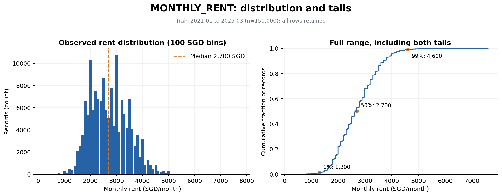
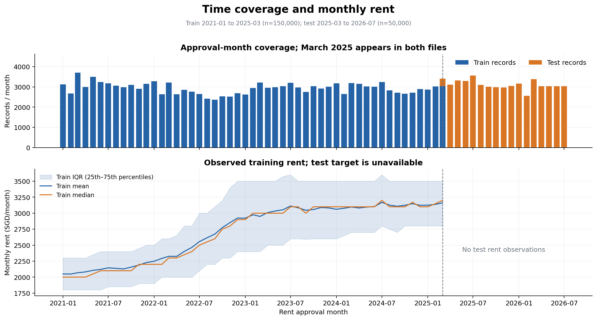
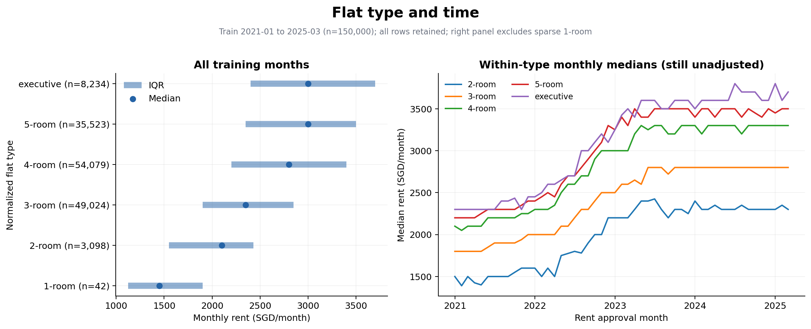
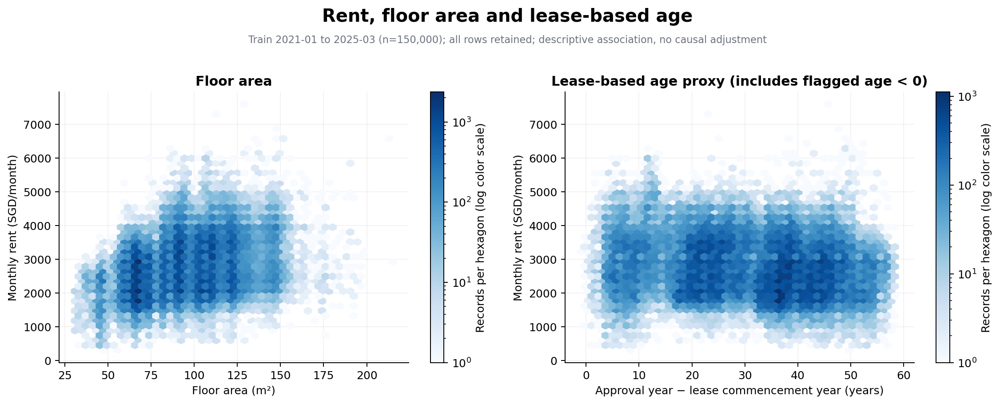

# Predicting HDB Monthly Rents Across Future Months

CS5228 progress-report working draft · 26 September 2026

Team name, member names and student IDs await team confirmation. This draft completes the problem description and exploratory data analysis (EDA). No model training, validation scores or Kaggle submissions have been produced.

## 1. Problem and research questions

The project predicts an HDB flat's monthly rent from its rental approval month, location and housing characteristics. The intended use is to support rent comparisons for prospective tenants and provide a reference for landlords and agents. The course emphasises justified data preparation, modelling choices, interpretation and limitations, beyond leaderboard rank. This is supervised regression: `MONTHLY_RENT`, in SGD/month, is the target. Inputs comprise supplied property attributes and auxiliary information whose availability at prediction time can be established. [Course task](../docs/Project%20Desc.md)

The project guide records Kaggle's metric as root mean squared error (RMSE): the square root of the mean squared difference between predicted and observed rents. Evaluation will use the original SGD/month scale, retaining every validation record with equal weight. Lower RMSE is better. Monthly bias, grouped errors and tail contributions will diagnose failures without replacing this metric. [Evaluation guide](../docs/PROJECT_TASK_GUIDE.md)

Three questions guide subsequent experiments:

1. How well do housing attributes and building history predict future rents when the market changes over time?
2. Does explicit temporal modelling improve both near-term and longer-horizon RMSE relative to a simpler time representation in the same model?
3. Which additional building or location features provide reproducible gains after data quality and historical availability are controlled?

EDA establishes the conditions behind these questions; it does not answer them with predictive evidence.

## 2. Data scope and schema

Table 1 summarises the actual CSVs. The course description ends at June 2026, whereas the local test file extends to July 2026; the team must clarify this discrepancy. Test rent values are absent. All target summaries use training data only. [Core audit](../experiments/eda/core/summary.json)

| Table 1. Core data | Records | Columns | Approval months |
| --- | ---: | ---: | --- |
| Training | 150,000 | 11, including target | January 2021–March 2025; 51 months |
| Test | 50,000 | 10, without target | March 2025–July 2026; 17 months |

| Table 2. Field group | Fields and observed training scope |
| --- | --- |
| Time | `RENT_APPROVAL_DATE`: month string, parsed as `YYYY-MM` |
| Location | `TOWN`: 26 values; `BLOCK`: string with possible letter suffix; `STREET`: 1,146 raw spellings |
| Housing categories | `FLAT_TYPE`: 11 raw values; `FLAT_MODEL`: 20 design categories |
| Size and lease | `FLOOR_AREA_SQM`: floating point, 31–215 m²; `LEASE_COMMENCE_DATE`: integer year, 1966–2022 |
| Constants | `FURNISHED`: `yes`; `FEE`: 0 in both splits |
| Target | `MONTHLY_RENT`: integer SGD/month, 300–7,600, training only |

Neither split contains parsed missing values or blank strings in core fields. Months parse successfully, and area and rent are finite and positive. Lease-based age is approval year minus lease commencement year, an annual-resolution proxy rather than exact age since construction. Full profiles and frequencies are in the [field overview](../experiments/eda/core/field_overview.csv) and [category table](../experiments/eda/core/category_frequencies_raw.csv).

## 3. Rental patterns

### 3.1 Distribution and time

Mean rent is SGD 2,719.04/month, median SGD 2,700/month and standard deviation SGD 749.73/month. The middle half spans SGD 2,100–3,200; the first and ninety-ninth percentiles are SGD 1,300 and 4,600. Although 98.72% of targets are multiples of SGD 50, the cause is unverified; this does not justify automatically rounding predictions. [Rent statistics](../experiments/eda/core/summary.json)



Figure 1. All 150,000 training records, January 2021–March 2025. Rent is in SGD/month; histogram bins are SGD 100. No tail observations are removed.

Monthly mean rent increases from SGD 2,048.90 in January 2021 (3,129 records) to SGD 3,162.71 in March 2025 (3,032 records). Annual means are SGD 2,121.14 in 2021, 2,524.06 in 2022, 3,035.90 in 2023 and 3,109.67 in 2024. The 2025 first-quarter mean is SGD 3,142.46, not a full-year observation. Earlier increases and later fluctuations motivate temporal testing; neither continued growth nor a future plateau is established. Monthly summaries also reflect changing rental composition. [Monthly](../experiments/eda/core/rent_by_month.csv) and [annual summaries](../experiments/eda/core/rent_by_year.csv)



Figure 2. Coverage uses all 150,000 training and 50,000 test records through July 2026. Rent summaries use training only through March 2025, in SGD/month. Interquartile ranges describe observations, not confidence intervals.

### 3.2 Town and flat type

Ang Mo Kio's median is SGD 2,500/month from 8,283 records; Bukit Timah's is SGD 3,000/month from 438 records. Town interquartile ranges overlap and sample counts differ substantially. These marginal comparisons do not isolate location premiums from size, type or time. [Town summaries](../experiments/eda/core/rent_by_town.csv)

After normalisation, the largest groups are 4-room flats (54,079 records) and 3-room flats (49,024), with medians of SGD 2,800 and 2,350/month. The 5-room and executive medians are both SGD 3,000/month. Only 42 observations are 1-room flats. Changes remain visible within flat types over time, so the aggregate pattern cannot be attributed solely to flat-type proportions. Other composition effects remain unresolved. [Flat-type summaries](../experiments/eda/core/rent_by_flat_type.csv)



Figure 3. All training records, January 2021–March 2025; rent in SGD/month. The sparse 1-room group remains in the distribution panel and overall statistics but is omitted from monthly trajectories.

### 3.3 Area and lease-based age

Rent correlates positively with area (Pearson 0.329; Spearman 0.318) and negatively with lease-based age (Pearson −0.178). Median rent reaches SGD 3,000/month in each area band from 110 m² upward rather than increasing proportionately. Age-band medians are not strictly monotonic. These observations motivate nonlinear relationships and interactions, without establishing causal effects or monotonic constraints. [Area bands](../experiments/eda/core/rent_by_area_band.csv), [age bands](../experiments/eda/core/rent_by_age_band.csv) and [correlations](../experiments/eda/core/summary.json)



Figure 4. All 150,000 training records, January 2021–March 2025, without sampling. Axes use m², years and SGD/month. Hexagon colours show record counts on a logarithmic scale.

## 4. Data quality and proposed cleaning

Unicode NFKC normalisation, trimming, lowercasing and whitespace compression reduce training street spellings from 1,146 to 576. Mapping `N room` and `N-room` to `N-room` reduces flat types from 11 to 6. Building identifiers must retain letter suffixes; `FLAT_MODEL` remains separate. [Normalisation map](../experiments/eda/core/category_normalization_map.csv)

After normalisation, 620 training groups are identical across all available columns, corresponding to 641 excess rows if one were retained per group. More importantly, 17,900 groups have identical inputs but different rents, involving 39,540 records. Without unit or transaction identifiers, neither case proves erroneous duplication. Building-month repeats may represent distinct units or contracts. We retain all records. [Duplicate audit](../experiments/eda/core/duplicates.csv) and [multiple-target audit](../experiments/eda/core/identical_X_multiple_targets.csv)

The training interquartile-range rule flags 752 rents outside SGD 450–4,850/month and 130 areas outside 5–173 m². These are review flags, not deletion criteria. One record has lease-based age −1: approval in November 2021 and lease commencement in 2022. It remains flagged without forcing age to zero. [Anomaly flags](../experiments/eda/core/anomaly_flags.csv)

Recommended derived-data rules are to apply deterministic spelling mappings, omit the two constants from model inputs, retain tails and repeated transactions, and preserve source order and anomaly flags. Learned vocabularies, imputers, scaling, rarity thresholds and target statistics must be fitted within each training fold. Full-training EDA thresholds cannot be reused as if learned before an earlier cutoff. Raw CSVs remain unchanged.

## 5. Train–test shift and building coverage

The main shift is temporal: 49,620 test records (99.24%) occur after March 2025. The remaining 380 share that month with 3,032 training records; monthly dates cannot establish within-month ordering. The maximum horizon is 16 months, and 30,234 test records (60.468%) lie at horizons 7–16. These counts motivate long-horizon evaluation, not a new weighted Kaggle metric. [Horizon profile](../experiments/research/priority_profile.json)

Normalisation reduces flat-type total variation distance from 0.2394 to 0.0101; town distance is 0.0201. Area's standardised mean difference is −0.0352, and test areas remain within the full training range. Small marginal differences do not establish stable conditional rents; test target drift cannot be measured without labels. [Feature drift](../experiments/eda/core/feature_drift.csv)

Training contains 9,406 normalised buildings, test contains 8,940, and 8,890 are shared. Thus 49,898 test rows (99.796%) belong to previously observed buildings; 102 rows belong to 50 new buildings. Restricting history to October 2024–March 2025 leaves 7,009 test rows without building history in that window, suggesting a recency–coverage trade-off. Historical rent features must exclude each training row's own target and unavailable same-month labels, and remain frozen at the validation cutoff. [Coverage audit](../experiments/eda/core/summary.json)

## 6. Auxiliary-data audit

All six files have been profiled. Complete fields, ranges and checks accompany the [auxiliary summary](../experiments/eda/auxiliary/summary.json).

| Table 3. Auxiliary source | Records / columns | Information and limitations |
| --- | ---: | --- |
| HDB buildings | 9,464 / 11 | Address, coordinates, maximum floor, completion year and planning geography; undated snapshot |
| MRT | 243 / 8 | Codes, names, coordinates and status; 192 names, 231 open-code records and 12 planned-code records; no opening dates |
| Schools | 337 / 14 | Coordinates, level and type; only 179 explicitly labelled `primary`; no opening or relocation history |
| Shopping malls | 113 / 3 | Names and coordinates; no opening or closure dates |
| COE | 539 / 8 | Category, month, round, premiums, quota and bids; January 2021–August 2026 |
| Stocks | 91,642 / 9 | Daily prices and volume for 77 symbols; 4 January 2021–30 July 2026 |

### 6.1 HDB joins

Normalised `TOWN + BLOCK + STREET` matches every training and test row to exactly one HDB record: 100% coverage, zero ambiguous keys and zero unmatched keys. Raw row-match rates were 79.48% and 79.04%. Formatting resolves the observed failures without fuzzy matching. Subsequent joins should enforce many-to-one validation and preserve row order. [Match rates](../experiments/eda/auxiliary/hdb_match_rates.csv)

Complete matching does not imply complete attributes. HDB contains 285 `NIL` postal codes and 11 occurrences each of `MAX_FLOOR=-1` and `YEAR_COMPLETED=-1`. Convert these to derived missing values with indicators; postal codes remain strings. Completion exceeds lease commencement year for 422 training rows across 26 buildings and 152 test rows across 25 buildings. The dates must not be silently substituted. Maximum building floor is not unit floor, and completion year is not snapshot publication time.

### 6.2 Historical availability

MRT codes must not be counted as distinct physical stations without an entity definition. Current `open` status does not establish operation in 2021; planned stations remain separate. School and mall distances face similar snapshot limitations. Coordinate range checks establish neither positional accuracy nor historical availability.

COE includes three records after the last test month. Stocks contain 85 rows with missing prices and 72 inconsistent open/high/low/close records; these remain unresolved flags. Same-month economic summaries may be unavailable at approval time. Under a fixed March 2025 prediction origin, later realised COE and stock values remain future information even when lagged by one month. Publication timing, adjusted-price history and company-selection provenance require verification. [Quality and timing discussion](../docs/EDA_REPORT.md)

## 7. Proposed evaluation and experimental status

The following windows have verified counts but await a shared protocol decision. They predict future months from fixed origins, without updates using future observed rents. [Window counts](../experiments/research/validation_windows.csv)

| Table 4. Proposed window | Training months / records | Validation months / records |
| --- | --- | --- |
| V1: recent development | January 2021–March 2024 / 114,842 | April–September 2024 / 17,960 |
| VL: long-horizon stress test | January 2021–May 2023 / 84,902 | June 2023–September 2024 / 47,900 |
| V2: recent confirmation | January 2021–September 2024 / 132,802 | October 2024–March 2025 / 17,198 |

V1 and VL overlap and must not be pooled as independent evidence. V2 has informed EDA and is not a fully blind holdout. Early stopping and tuning should use complete months within each outer training period. Report original-scale RMSE with horizon, town, flat type, rent-tail and seen/unseen-building diagnostics and sample counts.

The reviewed experimental order is TabM, time-modulated TabM, TabICLv2, TabPFN-3.5 and ModernNCA. These remain hypotheses, not established winners; mean, Ridge and tree baselines remain comparisons. The [priority plan](../docs/research/PRIORITY_PLAN.md) and [research report](../docs/research/METHOD_RESEARCH.md) document rationale and literature. GPU use is permitted; costs require measurement. No model, RMSE result, prediction file or Kaggle score exists at this stage.

## 8. Next steps and reproducibility

B/C should agree on cleaning and temporal validation, retain repeated transactions and tails, establish common baselines, and test hypotheses through controlled feature additions. D should record configurations, failures, errors and runtime. The team must resolve the March overlap, July discrepancy, auxiliary effective dates, anomalous year semantics and prediction-origin policy before claiming historical validity.

All four figures use full-sample outputs from [the EDA pipeline](../notebooks/README_EDA.md). From the project root:

```bash
python3 -m venv .venv-eda
.venv-eda/bin/python -m pip install -r notebooks/requirements-eda.txt
.venv-eda/bin/python notebooks/run_eda.py
```

The tested environment is Python 3.12.14, pandas 2.2.3, NumPy 2.3.5 and Matplotlib 3.10.6. The [run manifest](../experiments/eda/run_manifest.json) records input and source hashes. Test features served only distribution, coverage and join audits. No test targets or future economic observations fitted predictive features. This working draft awaits factual team review before experimental results are added.
